# Sprig


A family app: kids' tasks, stars and rewards first, with a shared family calendar on everyone's phone and the wall. Each family signs in with Apple, Google or email, with
guardian and kid roles.

**Status:** shows and edits iCloud calendars next to events added on the display, with Reminders lists, kids'
tasks and reward jars, a photo album and screen saver. Everything lives in a SQLite file on this machine. Google
sync and the Raspberry Pi setup come next (see "What's next").

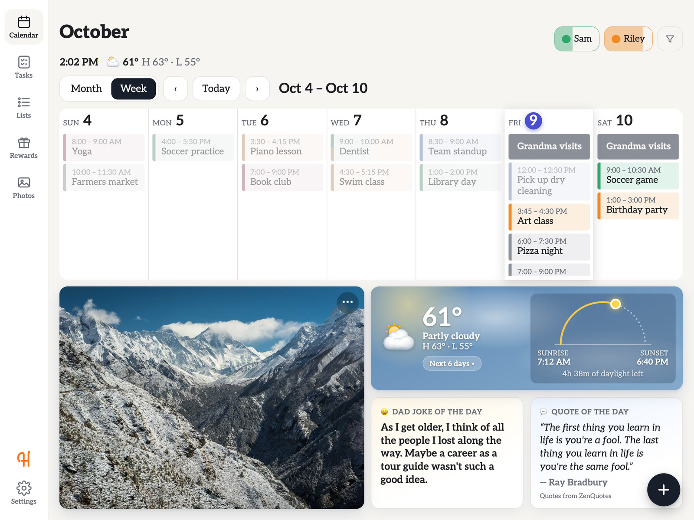

## See it in action

The people, events and photos below are made up for the demo.

### Calendar

Week, day and month views; tap an event to see it, filter by person, and add events with address
suggestions and drive times. After a while idle, the screen saver takes over.

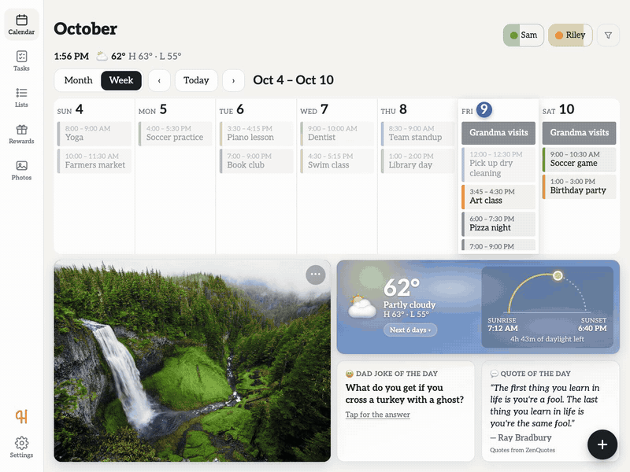

### Tasks

Tasks and goals for each kid. Tasks (daily ones and chores) are required, and finishing the day's tasks gets a
Hooray. Goals earn stars any day they're done, up to five at a time. Parents catch kids being good for stickers and
stars. Each kid has a History, and parents can add, edit and reorder tasks and goals, including one-time ones.


### Rewards

Kids put their stars into reward jars. A full jar is earned and then redeemed, and parents can edit jars or
make new ones.

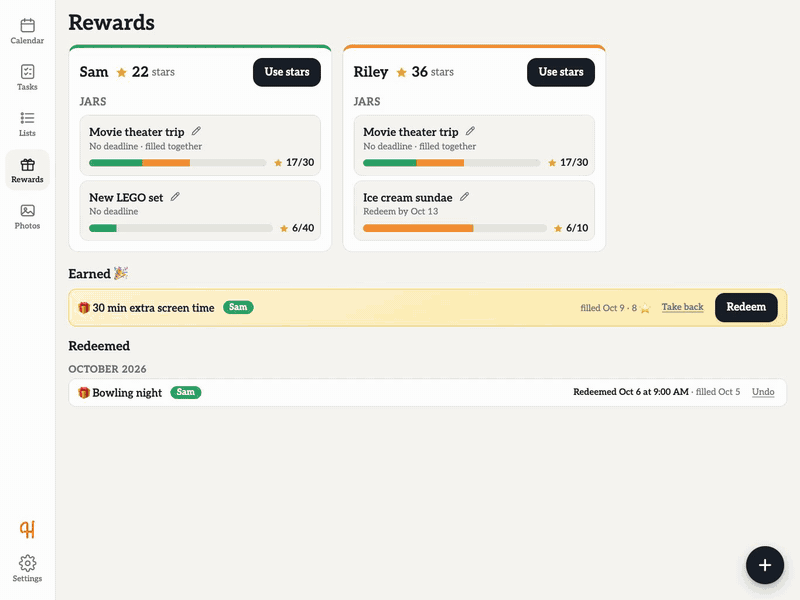

### Photos

The family album: browse photos, pick the ones the screen saver shows, and flip through them on the calendar.

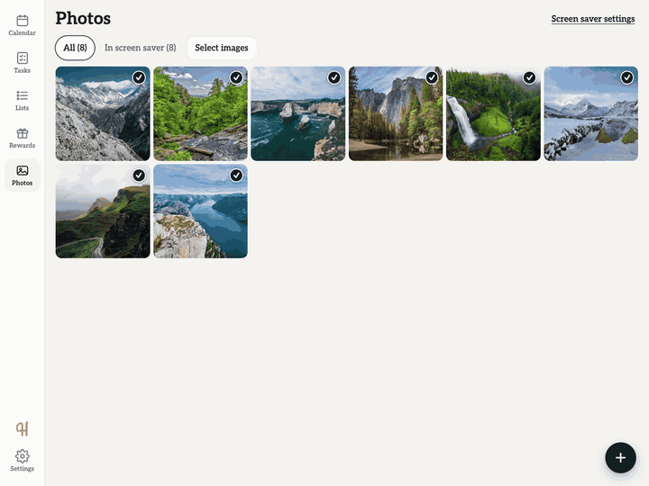

### Screenshots

|                                                                                                             |                                                                                   |
| ----------------------------------------------------------------------------------------------------------- | --------------------------------------------------------------------------------- |
|  **Week**                                                              | 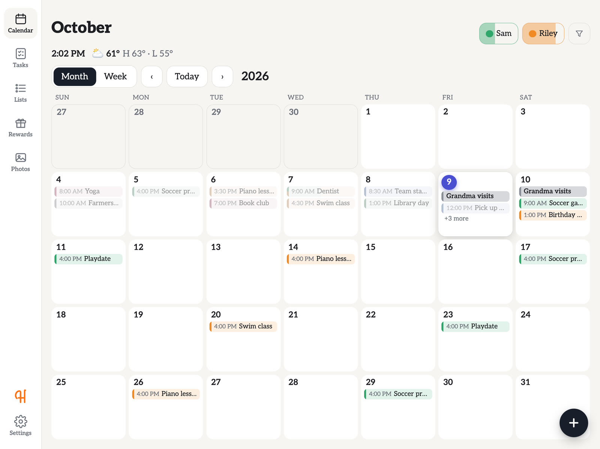 **Month**                                 |
| 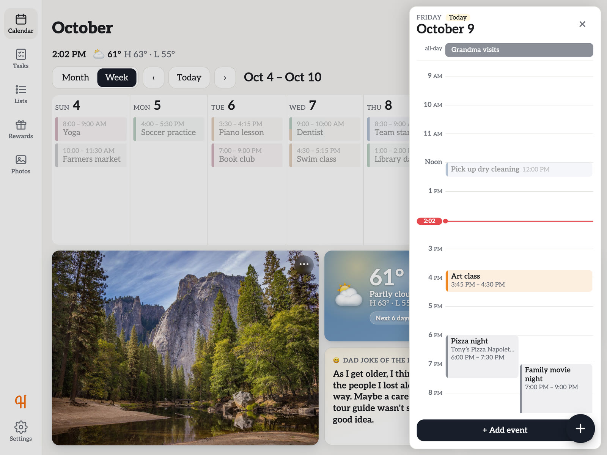 **Day**                                                                 | 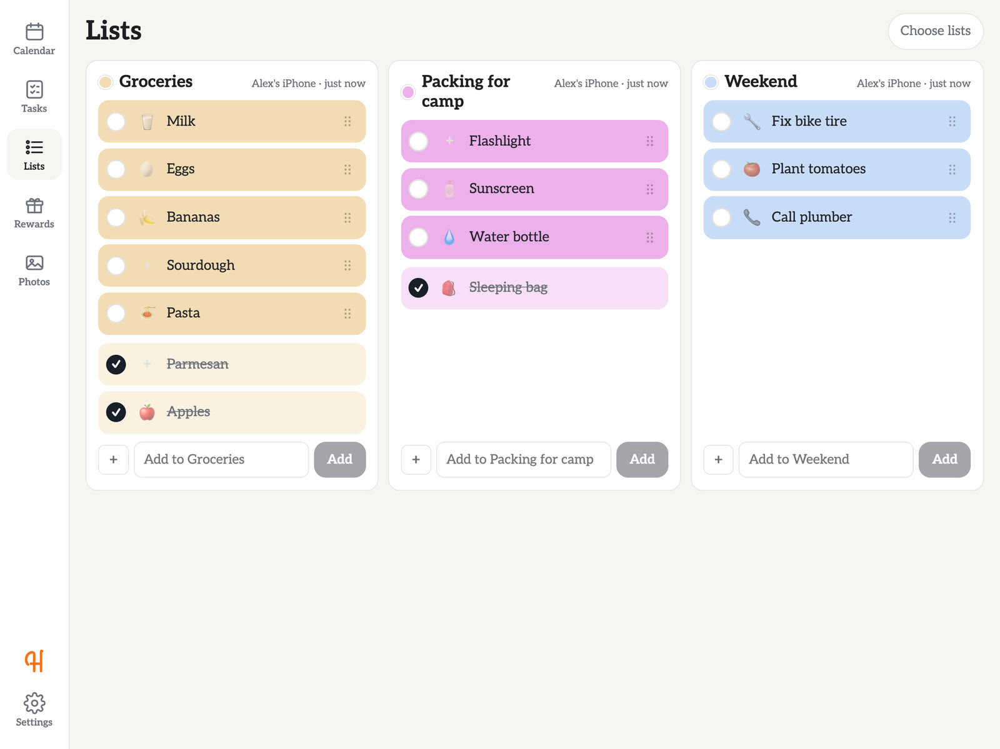 **Lists** (shared Reminders lists)                 |
| 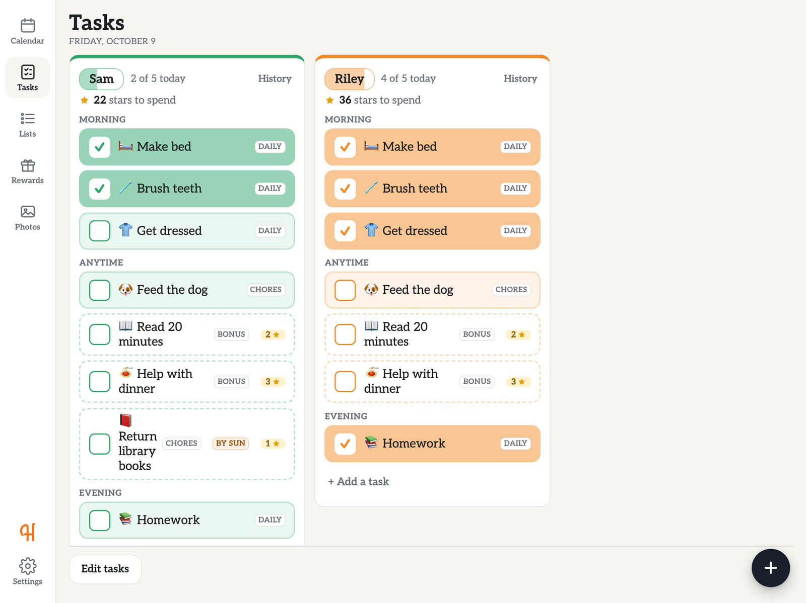 **Tasks**                                                                    | 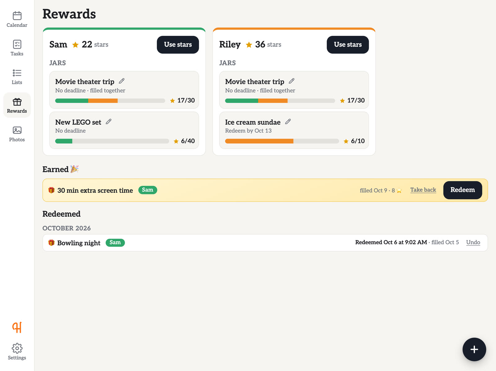 **Rewards**: jars filling, earned and redeemed |
| 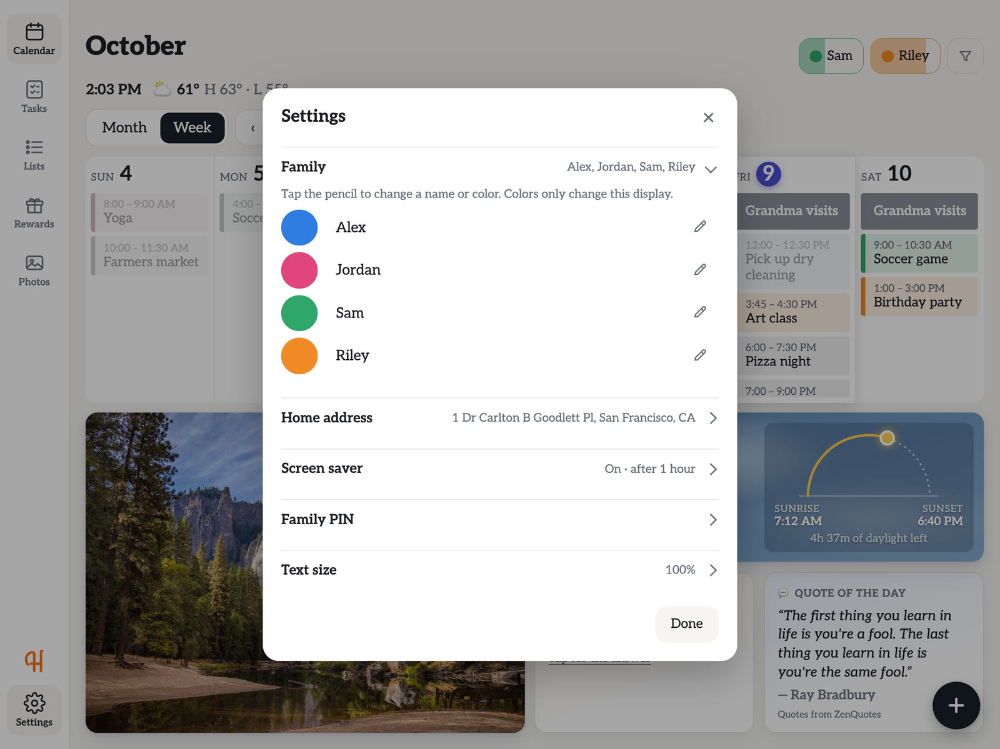 **Settings**                                                           | 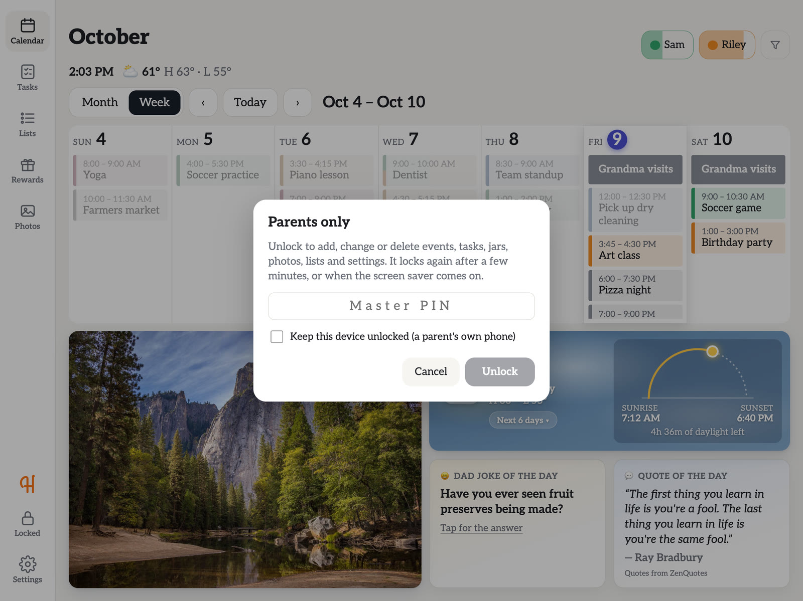 **Parent lock**: view-only until unlocked        |
| 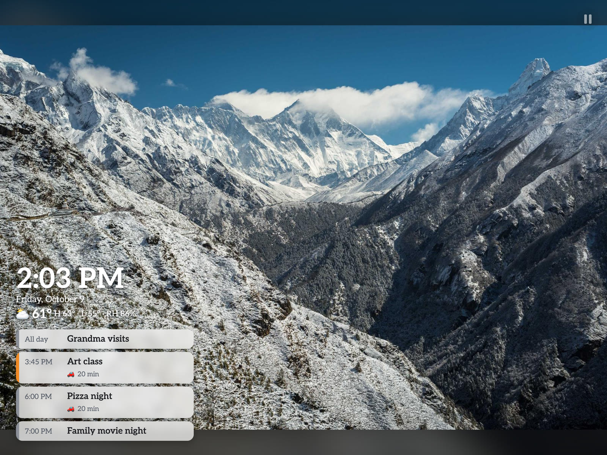 **Screen saver**: photos, the time, weather and today's events |                                                                                   |

## Run it on your computer

Needs [Node.js 22 or newer](https://nodejs.org).

```sh
npm install
npm run dev
```

Open http://localhost:5173. The API runs on port 3000; the page reloads as you edit code.

To run it the way the wall display will (one process, built UI):

```sh
npm run build
npm start          # http://localhost:3000
```

Data lives in `data/calendar.db`. Delete that file to start over.

## Accounts and households

Each family is a **household**; one server holds many. People sign in with **Apple**, **Google** or a **code
sent by email** (no passwords), and each has a role:

- **Guardians** (parents) start the household, invite each other, and can change anything from their own phone.
  Each sets a **guardian PIN** in Settings → People and sign-in.
- **Kids**: an older kid with their own phone and account is invited like a guardian, as a kid. A younger kid's
  device (an iPad, say) is added with a code and needs no account.
- **The wall** is added with a code (Settings → **Add a wall display**, then type the code on the wall). It opens
  with **any guardian's PIN**, and the same PIN unlocks it for changes. **Lock the wall** in Settings sends it back
  to the PIN screen.

Codes look like `K7QP-3MXD`, work once, and last 7 days (15 minutes for the wall). **Send the link** shares a link
that opens the app with the code filled in. Settings lists who signs in and how, unused codes, and every signed-in
device, with **Sign out** for each.

**Your household from before accounts** (`data/calendar.db`) is kept, with everything in it. Until a guardian
claims it, the server logs a line on each start: `Claim your household: … enter ABCD-EFGH`. Sign in, tap **Join
with a code**, enter it and pick who you are; then invite your co-parent and add the wall from Settings. The old
family PIN and master PIN are no longer used. The iCloud and Reminders setup in `.env` stays with this household.

To turn on the sign-in buttons, fill in `.env` (see `.env.example`):

- **Google:** in [Google Cloud Console](https://console.cloud.google.com) → APIs & Services → Credentials, create an
  **OAuth client ID** of type *Web application*, with your site's address (and `http://localhost:5173` while
  developing) under **Authorized JavaScript origins**. Put it in `GOOGLE_CLIENT_ID`.
- **Apple:** needs an Apple Developer account and an HTTPS address. Create a **Services ID** with Sign in with Apple
  turned on, your domain, and `https://<your domain>/` as the return URL. Put it in `APPLE_SERVICE_ID`.
- **Email:** a [Resend](https://resend.com) key in `RESEND_API_KEY` and a sender in `EMAIL_FROM`. While developing,
  codes are printed in the server's log instead.

Accounts live in `data/accounts.db`; each new household gets `data/households/<id>/` (its database and photos).

**Who's signed in** shows at the bottom of the left bar: the person's initial in their color (or a screen, on
the wall). Tap it to see the account and household, switch households, sign out, or lock the wall. When the wall
or a kid's device is unlocked, the lock shows whose PIN opened it.

## Google Calendar

Each person connects their own: on their phone, **Settings → Calendars → Connect my Google Calendar**. Google
asks them to let the app see their calendars, then sends them back. Every calendar in that account shows up (the
person's own main calendar is linked to them; shared ones go **By event**), synced every 5 minutes. A calendar
two people both have (one shared between parents, say) shows once. Google events are view-only on the wall for
now: change them in Google Calendar. **Disconnect** removes the account's calendars and tells Google to drop
the app's access.

Setting it up (once, for the server), in the same Google Cloud project as Google sign-in:

1. **APIs & Services → Library**: enable the **Google Calendar API**.
2. **OAuth consent screen**: add the scope `.../auth/calendar.readonly`. While the app is in *Testing*, add each
   person's Gmail address under **Test users** (up to 100). Opening it to everyone needs Google's verification.
3. **Credentials**, on the Web client used for sign-in: add `http://localhost:5173/api/account/google/callback`
   (and later `https://<your domain>/api/account/google/callback`) under **Authorized redirect URIs**.
4. Put the client's secret in `GOOGLE_CLIENT_SECRET` and restart.

Refresh tokens are stored encrypted (`server/secrets.ts`), with the key in `SECRET_KEY` or `data/secret.key`.

## Hosting (Fly.io)

One small always-on server with a disk, about $5–7 a month: a 1 GB server, a 3 GB disk, and a storage bucket
for backups. The app is at `https://<app>.fly.dev` (a custom domain can be added later).

| File                      | What it does                                                                                    |
| ------------------------- | ----------------------------------------------------------------------------------------------- |
| `Dockerfile`              | Builds the app and the web UI, and adds Litestream. Fly builds it, so Docker isn't needed here. |
| `fly.toml`                | The server: always on, 1 GB, the disk at `/data` (snapshotted daily, kept 14 days), `/health`.  |
| `deploy/start.sh`         | Starts it: imports uploaded data if there is any, then runs the app under Litestream.           |
| `deploy/litestream.yml`   | Backs up every database in `/data` (new households too) to the bucket as it changes.            |
| `deploy/set-secrets.sh`   | Sends the needed `.env` settings (and the token key) to Fly as secrets.                         |
| `deploy/upload-data.sh`   | Copies this machine's data (accounts, households, photos) up, replacing what's there.           |

Once, to set it up:

```sh
brew install flyctl && fly auth login
fly launch --no-deploy --copy-config --name <app>   # picks the nearest region
fly volumes create household_data --size 3 --yes
fly storage create --name <app>-backups --yes       # the backup bucket; sets its keys as secrets
deploy/set-secrets.sh
fly deploy
deploy/upload-data.sh                               # stop `npm run dev` first
```

After that, `fly deploy` ships each change. `fly logs` shows the server's log (sign-in codes too, until email is
set up), and the Fly dashboard shows memory, CPU and the bill.

- **Moving over:** once the data is uploaded, use the hosted app, not `npm run dev` on the same data: both would
  sync iCloud and send the wall's edits. The Mac Reminders sync (`REMINDERS_MAC`) doesn't run on the server; the
  iPhone Shortcut does, now from anywhere, at `https://<app>.fly.dev`.
- **Google:** add `https://<app>.fly.dev` under Authorized JavaScript origins and
  `https://<app>.fly.dev/api/account/google/callback` under redirect URIs.
- **Restoring a backup:** `fly ssh console`, then `litestream restore -config /app/deploy/litestream.yml <path>`
  for a database. Photos are covered by the disk snapshots (`fly volumes snapshots list`).

## Connect iCloud

Each person connects their own iCloud Calendar in the app. Nothing goes in `.env`.

1. At [account.apple.com](https://account.apple.com) → Sign-In and Security → **App-Specific Passwords**,
   create one called "Sprig". Your normal Apple password is never used, and you can revoke this one anytime.
2. In Settings → **Calendars**, tap **Connect my iCloud Calendar** and enter your Apple ID and that password. It's
   checked with iCloud first, then stored encrypted (like Google's tokens, with `SECRET_KEY`).
3. It syncs right away and every 5 minutes after, from 3 months back to 13 months ahead. **Disconnect** removes its
   calendars from the app.

Connecting needs a guardian: from their own phone, or on the wall or a kid's device after a guardian's PIN. The
household from before accounts can still use `ICLOUD_APPLE_ID` and `ICLOUD_APP_PASSWORD` in `.env`.

Tap an iCloud event to see it, edit it or delete it (see "Using it"). In that view you can also pick **who it's for**. The pick is kept on this display, covers every repeat of the event, and
survives future syncs.

**Calendars:** in Settings, link each iCloud calendar to a person (all its events become theirs) or leave it on
**By event**, and untick **Show** to keep a calendar off the wall. Who an event is for is decided in this order:
your pick on the event, then the calendar's person, then Claude's pick from the title.

**Sort by person automatically (optional):** add `ANTHROPIC_API_KEY` to `.env` and restart. After each sync, Claude
reads the titles of events nobody has assigned yet (and your family's names) and picks who each is for, e.g.
"Sam - swim class" goes to Sam and "Riley & Sam dentist" to both. Your own picks always win. Event titles and family names are sent to the
Anthropic API.
If syncing fails (wrong password, no internet), a banner says so and the last synced copy stays on screen.

## Connect Reminders

iCloud Reminders have no API a Raspberry Pi can use (Apple moved them off CalDAV in iOS 13), so each iPhone syncs them with a Shortcut. Each phone sends its lists to the wall; items added or ticked off on the wall wait (marked ↻) until a phone that has that list runs the Shortcut and applies them. Lists shared between you show up from either phone; private lists come from their owner's phone only.

1. `.env` needs `REMINDERS_TOKEN` (any long random text) and the server must be reachable on your Wi-Fi:`HOST=0.0.0.0`. Restart after changing either.
2. On each iPhone, make a Shortcut called "Sync wall lists". Use the Pi's address, the token, and a name
   for the phone (e.g. `Alex`):
   1. **Get Contents of URL** `http://<pi-address>:3000/api/reminders/phone/pending?device=Alex`,
      header `Authorization` = `Bearer <token>`. Get the dictionary value `changes`.
   2. **Repeat with Each** change: if `op` is `add`, add a reminder titled `title` to the list named `list`;
      if `complete` or `uncomplete`, find the reminder in `list` with that `title` and set it completed or not.
      Add each change's `id` to a list variable `applied`.
   3. **Find Reminders** that are not completed, plus ones completed in the last day. For each, make a
      dictionary `{ list: <List name>, title: <Title>, done: <Is Completed>, due: <Due Date> }` and add it to
      a list variable `items`.
   4. **Get Contents of URL** `http://<pi-address>:3000/api/reminders/phone/sync`, method POST, same
      header, JSON body `{ device: "Alex", items: <items>, applied: <applied> }`.
3. Automations (Shortcuts > Automation, set to run immediately): **App > Reminders > Is Closed**, so changes
   reach the wall as soon as you leave Reminders, plus a few **Time of Day** runs so wall changes reach your
   phone even when you don't open Reminders.

The Shortcut only works while the phone is on your home Wi-Fi; runs elsewhere just fail quietly.

**On a Mac (before the Pi):** the server can sync this Mac's Reminders itself, with no Shortcut. Put
`REMINDERS_MAC=1` in `.env` (plus `REMINDERS_TOKEN`) and restart. It reads every list, empty and shared ones
included, every `REMINDERS_MINUTES` (default 5), and sends wall changes to Reminders a few seconds after
they're made. The first run, macOS asks to let the app running the server control Reminders; allow it.
Lists can be hidden from the wall with **Choose lists** on the Lists page.

## Travel times

Events with an address (iCloud's location, or the **Address** field on events added here) get a **Travel time**
button: the drive from home with predicted traffic, and when to leave to be there 10 minutes early (for parking and walking in). From there,
**Remind me** sets a "time to leave" alert on the wall (at leave time, or 10 or 15 minutes before), with a chime.
Traffic is checked again about 30 minutes before leaving, and the alert moves if the drive got longer.

1. In [Google Cloud Console](https://console.cloud.google.com), create a project, enable the **Routes API**, and
   turn on billing (Google's monthly free credit covers a family's use many times over).
2. Create an API key under **APIs & Services → Credentials** and restrict it to the Routes API.
3. Put it after `GOOGLE_MAPS_API_KEY=` in `.env` and restart. Set your home address in **Settings**.

Each tap asks Google twice (to match traffic to when you'd leave); answers are reused for 10 minutes. Alerts show on
the wall, and on the phones of who the event is for (everyone's grown-ups when it's for anyone or a kid) if they have
**Alerts** on (see "Alerts on phones").

## On phones (home-screen app)

The app installs on iPhones and Android phones as a home-screen app: full screen, with its own icon, and it opens even
without a connection (showing what it last loaded). Data always comes from the wall's server.

1. The phone has to reach the server. At home, put `HOST=0.0.0.0` in `.env` on the machine running it and restart.
   Away from home, use [Tailscale](https://tailscale.com) (free for a family): install it on the server machine and
   each phone, and the phones can reach it from anywhere, privately.
2. On the phone, open the server's address in Safari and tap **Share → Add to Home Screen**. While developing on
   the Mac (`npm run dev`) that's `http://<mac's address>:5173` (the page server follows `HOST` too); on the Pi
   (`npm start`), `http://<pi's address>:3000`.

Sign in as described in "Accounts and households".
For the offline start and alerts, iPhones need the address to be HTTPS. With MagicDNS and HTTPS
certificates turned on in the Tailscale admin, run `tailscale serve --bg 5173` on the Mac while developing (`--bg 3000`
on the Pi): the app is then at `https://<machine>.<tailnet>.ts.net`, for your Tailscale devices only. Add it to the
home screen from that address; it works at home and away.

### Alerts on phones

In **Settings → Alerts**, a grown-up turns on **Alerts on this device**. Sprig then alerts that phone when a reminder
on its lists comes due (at its time, or 8 AM on the phone's clock for a reminder with only a day), and when it's time
to leave for an event. Reminders go to who they're for; ones for anyone, or for a kid, go to every grown-up with
alerts on. Each comes once (again if it's moved or unticked), and nothing older than 12 hours is sent. Tapping an
alert opens Sprig on Lists (or Today). Kids' devices and the wall don't get alerts.

- On iPhone and iPad (iOS 16.4 or later), alerts need Sprig added to the Home Screen and opened from there, over
  HTTPS (above). Android and desktop browsers need HTTPS too (`localhost` is fine on a computer).
- Alerts need the built app (`npm start`), since `npm run dev` doesn't run the service worker.
- The server's push keys are made in `data/vapid.json` on first start; keep it with the data. When hosting, set
  `VAPID_PUBLIC_KEY`, `VAPID_PRIVATE_KEY` (`npx web-push generate-vapid-keys`) and `VAPID_SUBJECT` (an https URL or
  `mailto:`) in `.env` instead.

## Using it

- **Parent lock:** a guardian signed in on their own phone can change anything. The wall and kids' devices start
  **locked**: events, tasks, jars, photos, lists and the calendar can be looked at, and kids can still tick tasks,
  put stars in jars, redeem (and undo it), upload photos and add or tick list items. Adding, changing or deleting
  anything else needs the **lock** in the left bar (or Settings) and **any guardian's PIN**. It locks itself again
  after 5 minutes without a touch, or when the screen saver starts. The server checks it too, so a locked device
  can't change those things any other way.

- **Today:** the first page in the left bar (`#today`), and where phones open. **Up next** lists your events for the
  rest of the day (yours, shared ones and family ones; the whole family's on the wall), with **Leave by** when it has an
  address, and tomorrow's first event. **The kids today** shows each kid's tasks, stickers and stars (tap to go to
  Tasks), with **✨ Caught being good**. **Needs you** appears when something's waiting: a calendar change that
  clashes, a reward to hand over, or items on a list. The rest of the family's day is folded at the bottom.
- **Month / Week:** switch views at the top left. ‹ › move by a month or a week.
- **Lists:** the **Lists** page in the left bar (address ends in `#lists`) has the family's own lists, kept in
  Sprig (**+ New list**: groceries, to-dos, packing), and your iCloud Reminders if they're connected (see "Connect
  Reminders"). Anyone adds items and ticks them off. On Sprig's lists a parent's **⋯** on an item gives it a day
  (and a time, if it matters) and who it's for: once it's due it shows under **Needs you** on Today, in red when
  late, and alerts phones that have alerts on. **⋯** by a list's name renames or deletes it, and **Clear done** takes ticked items off.
  Each list's items are shown in its color; tap the dot by a list's name to pick another. Drag an item by its ⋮⋮ to
  put it in order of importance (the color and order are kept on the wall; Reminders on the phones keeps its own order).
  Tap the spot before an item to give it an icon (search or **Show more** for every icon); it's added to the start of
  the item's name in Reminders, so phones show it too. Common groceries get a suggested icon (shown lighter until
  picked), and items added on the wall get theirs straight away. Renaming needs the Mac sync (`REMINDERS_MAC=1`); the
  phone Shortcut doesn't rename yet.
- **Time and weather:** under the month: the clock, the sky, the temperature now, and today's high and low, for the home address in Settings. Weather comes from [Open-Meteo](https://open-meteo.com) (free, no key); the address is found on a map once, through the US Census geocoder.
- **Daily cards:** in Week view, beside the weather: a **dad joke** (tap for the answer, from icanhazdadjoke.com) and
  a **quote of the day** (ZenQuotes). They're fetched once a day and kept; grim jokes are skipped (it's a family wall).
- **Day:** tap any day to see it in a panel on the right. Close it with ×.
- **Round + buttons:** Calendar, Tasks, Rewards and Photos each have one at the bottom right (add an event, a task, a
  reward jar, or upload photos). A task or jar started there has no one picked yet; each kid's task card has its own
  **+ Add a task**.
- **On phones** the bar runs along the bottom: **Today, Calendar, +, Tasks, More** (More has Lists, Rewards, Photos,
  who's signed in, the lock and Settings). The **+** in the middle turns into an ✕ and opens a stack of quick adds,
  on every page: **New event, Add to a list, Caught being good, Add a task, Add a photo** (to the album and screen
  saver), **Snap a flyer** and **Say it**. Locked, a kid's device only gets Add to a list and Add a photo. Tablets
  and computers keep the bar on the left.
- **Say it and Snap a flyer** (phones, with `ANTHROPIC_API_KEY`): say or type something like "remind me to call the
  dentist Friday at 10, and add milk to Groceries", or photograph a school flyer or invitation. Claude works out the
  list items (reminders with a when), events and kid tasks, and each shows as a card to change (title, list, day,
  time, who) or leave out (×); nothing is added until **Add**. Sent to the Anthropic API: the words or photo, today's
  date, the family's names and the list names, never anything from the calendar. A flyer's events get its other
  details (what to bring, cost, how to RSVP) as notes, and the photo is kept with them: open the event to see it
  (it stays out of the album, and goes once its events are deleted). Talking uses
  the browser's speech recognition where there is one; elsewhere, type or use the keyboard's 🎤.
- **Add:** the round **+** at the bottom right of the calendar (it starts on the day open in the day panel, else today),
  or tap a day, then **+ Add event** in the day panel.
- **Notes:** events kept in Sprig have a Notes box (iCloud and Google events don't, yet).
- **Who:** an event can be for any number of people: tap each person in **Who** (tap again to remove), or
  **Everyone** for no one in particular. Shared events get a bar split into each person's color.
- **Who sees it:** each event is for **👥 Everyone**, **⏳ Busy** or **🔒 Private**. Busy: anyone not on it sees a
  striped "Busy" block at that time, with no title or place, and can't open it. Private: anyone not on it doesn't
  see it at all. The people on an event always see it, and guardians see their kids' events in full; the wall is
  no one in particular. Each Google or iCloud calendar has a default in Settings (**Sees**), and an event can
  differ (it covers every repeat). The server leaves hidden details out, so they never reach another device, and
  private events are never sent to Claude. A kid's own device puts stars in jars only with a parent's PIN.
- **People:** tap a name at the top to show only their events (including ones they share) (or **Everyone** for events not for anyone in
  particular). Tap it again to show all. Each name fills with that person's color as they finish today's tasks.
- **Tasks:** the **Tasks** page (left bar; **Calendar** goes back; its address ends in `#tasks`, so a refresh or a
  bookmark opens it) shows a card for each kid with today's tasks, each with an optional icon,
  grouped into Morning, Anytime and Evening, then their **Goals**. **+ Add task/goal** opens one dialog with
  **Task | Goal** at the top. A **task** is required: **Daily** (the default) or **Chores**; tasks fill the kid's bar
  and name button. A **goal** is ticked any day they do it and earns the ★ stars you set (5 unless changed), which go in
  the kid's bucket (the card shows **stars to spend**; they're spent on the Rewards page). Pick a goal from the goal
  list (ones for the kid's age first) or type your own, which joins the list for every kid; **Choose which show** hides
  the ones you won't use (or all of them, with **Hide all**). A kid has at most five goals at once, counting ones for
  everyone. **✨ Caught being good** (top of the page) gives a kid a sticker and stars for being helpful, a good
  attitude, bravery, cleanliness, problem solving or self care; its **History** (and tapping a sticker on a card)
  takes one back. Tap the square left of a task's name to give it an icon. **Days**: every day, weekdays,
  weekends, chosen weekdays, or **One time**: due by a date (Today, Tomorrow, End of week, or any day), it's on the
  list every day until it's done (shown ticked that day) or its date ends, then it's gone; it's tagged **Today only**
  or **By Sat**. **History** on a card shows a week of ticks per task or a month calendar (tap a day to see and fix
  it). **Edit tasks**: drag ⋮⋮ to reorder within a part of the day, ✎ to change a task, 🗑 to delete (it asks to
  confirm first). A goal's stars can't be un-ticked once they're in a jar.
- **Hooray!** When a kid ticks the last of today's _required_ tasks (goals don't count; never just from a
  refresh; unticking takes it back, so a real finish after an accidental tick still cheers, but not twice within two
  minutes), or fills a reward jar, the screen
  fills with confetti and a big "Hooray, Sam!" (with what it's for) for a few seconds (tap to close); Android phones
  buzz too.
- **Kid mode:** **Kid mode** in the bar on the left (in **More** on phones, or under your avatar) turns this device
  into one kid's screen, with its own tabs (down the left, or along the bottom on phones) and no settings:
  **Today**, the events they're on (picked in **Who**) as big pictures with the next one picked out (today for Little,
  today and tomorrow for Early, the week from Middle on), and on a day with nothing on, a fun fact with a big
  picture and 🔊 to hear it; **Tasks**, their tasks and goals as big picture tiles
  (tap again to untick), stars and stickers; and **Rewards**, their jars. Putting stars in jars asks for a guardian's PIN first. **All kids** switches between them on a shared tablet. To leave, hold the exit
  button in the corner for two seconds and type a guardian's PIN. A kid's own device (added by code) is always in kid mode;
  the PIN unlocks the whole app until it locks again.
- **Potty chart:** **🚽 Start potty chart** under a kid's tasks. The card has a big row for each step (said I need
  to go, sat on the potty, went pee or poop, wiped and flushed, washed hands). Tap the glowing spot after a row's last
  sticker to add one (the pee or poop row asks which, with two big pictures; tap both for both); tap a new sticker again to take it off; stickers already saved do nothing. Each
  row takes one new sticker at a time, kept with **Save ✓**. Seven fill a row, and a full row is a star; when every row is full, Hooray, and a
  fresh card starts. **Edit** (parents; a guardian's PIN in kid mode) takes a row's last stickers off, or stops the
  chart (the card is kept).
- **Rewards:** the **Rewards** page (gift in the left bar, `#rewards`) is where kids spend their stars on **reward
  jars** that parents set up (the round +; ✎ beside a jar's name changes it). Each kid has a card with their
  **bucket** (stars earned from goals and moments, not yet spent) and their jars.
  - **Use stars:** tap a jar to place a star by it (a star flies from the bucket into the jar), − to take one back,
    then **Done** asks to confirm. Once in a jar, stars can't come out. Kids can't spend more than they have.
  - **Jars** can be for several kids: their stars **filled together**, or **each** putting in the full amount. With no
    deadline, a jar empties after it's redeemed and fills again. With a **deadline**, it's one time only.
  - **Earned:** a full jar moves here (with a Hooray), tagged with who earned it, until a parent taps **Redeem**.
  - **Redeemed:** everything redeemed, by month, with the date and time; **Undo** takes back a tap made by mistake.
  - **Missed:** a jar not redeemed by its deadline. Each kid moves their stars back to their bucket or into another
    jar; once it's empty, a parent **Adds it back** (with a new deadline or none) or **Removes** it.
  - Stars not yet redeemed go back to the kids when a jar is deleted, made smaller, or a kid is taken off it.
    **Take back** (guardians only) moves some of a kid's stars out of a jar into their
    bucket.
- **Photos:** the **Photos** page (left bar, `#photos`) is the family album. **Upload photos** takes several at
  once (drag them in, or choose them in Finder; you can also drop photos anywhere on the page); each is shrunk to wall size in the browser first (iPhone photos included).
  **Videos** upload the same way (iPhone .mov or .mp4). The server converts each to a 1080p H.264 .mp4 with no
  sound, keeping the first 45 seconds (it shows "Preparing video…" until then); in the album they have ▶ and their
  length. The screen saver and the photo card under the week play them muted, each for its full length. Converting
  uses ffmpeg from the `ffmpeg-static` package (nothing to install on the machine); if `npm install` says its
  install script wasn't run, allow it once with `npm install-scripts approve ffmpeg-static`. Photos in the screen
  saver have a ✓. **Select** starts with those selected; tap photos to change it, then **Save selection**. Tap a photo
  to see it full size (or delete it). Photos are stored in `data/photos` (not in git). To upload from phones, the server has to be
  reachable on your Wi-Fi (`HOST=0.0.0.0`). Untick **Add them to the screen saver** in the upload pop-up to keep a
  batch out of it.
- **Screen saver:** after 15 minutes without a touch, the wall shows the album full screen, shuffled, with the time
  and weather in a corner (not while a pop-up is open; "time to leave" alerts still show on top). Swipe for the
  next or previous photo; the small pause icon (top right) holds the current one and shows ‹ › to step through
  (arrow keys and Space on a keyboard). Tap anywhere else to close.
  In **Settings**: on or off, how long before it starts, how long each photo stays up (20 seconds by default),
  the transition (a mix, crossfade, slow zoom and pan, slide, zoom, blur or flip), and night hours when the photos
  are dimmed and change more slowly (10 PM to 6 AM by default); the same settings open from
  **Screen saver settings** on the Photos page, with **Play it now**.
- **Edit or delete:** tap an event. Delete asks twice, and you get 10 seconds to undo.
- **iCloud events:** tap one, then **Edit event** to change its title, time or address, or delete it. The change
  shows at once (marked ↻ until it's sent) and goes to iCloud after the 10-second Undo, then to your phones. For a
  repeating event, Save and Delete ask whether it's **this day only** or **every day** (every day can rename it, change
  its address, or move every day's time; all-day changes to a whole series are made on the phone). An event that's in
  two calendars (shown once) is changed or deleted in both. If iCloud can't be reached, changes wait and are
  retried with every sync. If the same detail was changed on another device meanwhile, the wall asks which version
  to keep (**Keep mine** or **Use iCloud's**); changes to other details on the phone are kept either way.
- **Family:** in **Settings** (the gear at the bottom of the left bar), rename people and change their color at any time. Adding and removing people is hidden for now (`CAN_ADD_OR_REMOVE` in `web/src/components/MembersPanel.tsx`). Colors only change this display.
  Removing a person keeps their events, shown in gray.
- **Text size:** in Settings, adjust for the screen (15.6" vs 21.5").

## How it's built

| Part          | Where                                 | Notes                                                                                                                                                          |
| ------------- | ------------------------------------- | -------------------------------------------------------------------------------------------------------------------------------------------------------------- |
| API + storage | `server/`                             | Fastify, better-sqlite3. Schema and migrations in `server/db.ts`.                                                                                              |
| Accounts      | `server/hosted.ts`, `accounts.ts`     | The front server: sign-in, households, invites, PINs, devices (`data/accounts.db`). Passes other calls to the household's own app (`app.ts`), with who's asking. |
| People        | `server/people.ts`                    | Who each synced event series is for: manual picks, then Claude (`claude-opus-5-5`, structured output) for the rest.                                            |
| Sync          | `server/sync.ts`, `server/providers/` | Pulls each calendar's events in a date window and replaces the stored copy. iCloud over CalDAV (`caldav.ts`); `ical.ts` expands repeating events with ical.js. |
| UI            | `web/src/`                            | React 19 + Vite, CSS modules. `App.tsx` is the shell; screens live in `components/`.                                                                           |
| Server data   | `web/src/lib/queries.ts`              | TanStack Query hooks: fetching, 60 s refresh, and cache updates after edits. No Redux; add it only if client-only state grows.                                 |
| Tests         | `server/*.test.ts`                    | `npm test`                                                                                                                                                     |

Checks: `npm test` and `npm run check` (TypeScript for server and UI).

The server listens on localhost only. `HOST=0.0.0.0 npm start` makes it reachable from phones on
your Wi-Fi; every device signs in first (see "Accounts and households").
